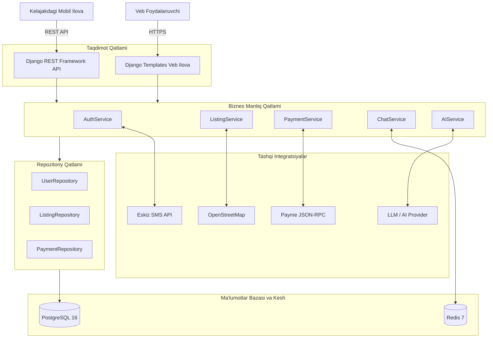
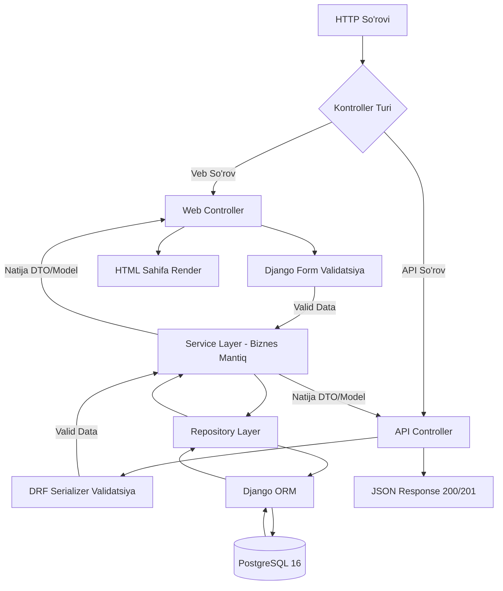
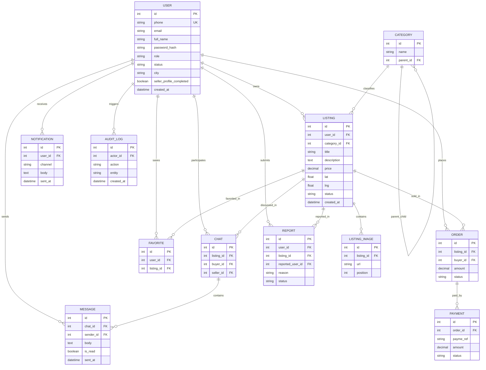
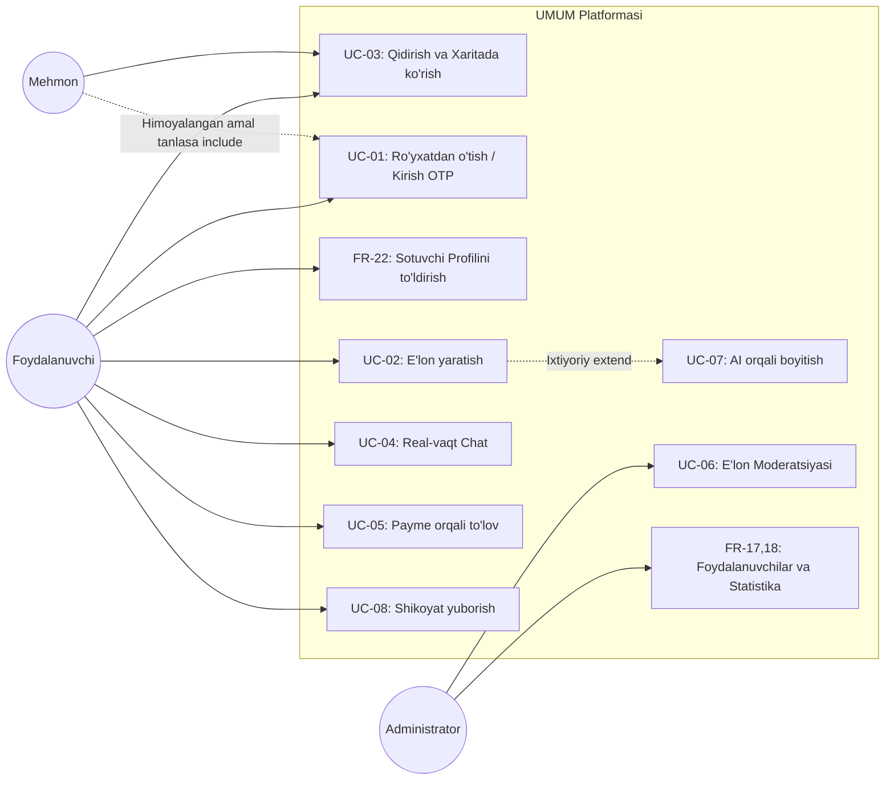
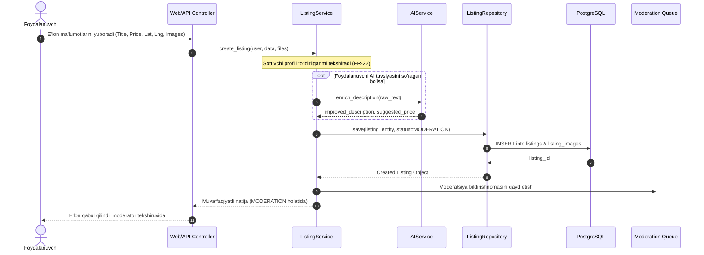
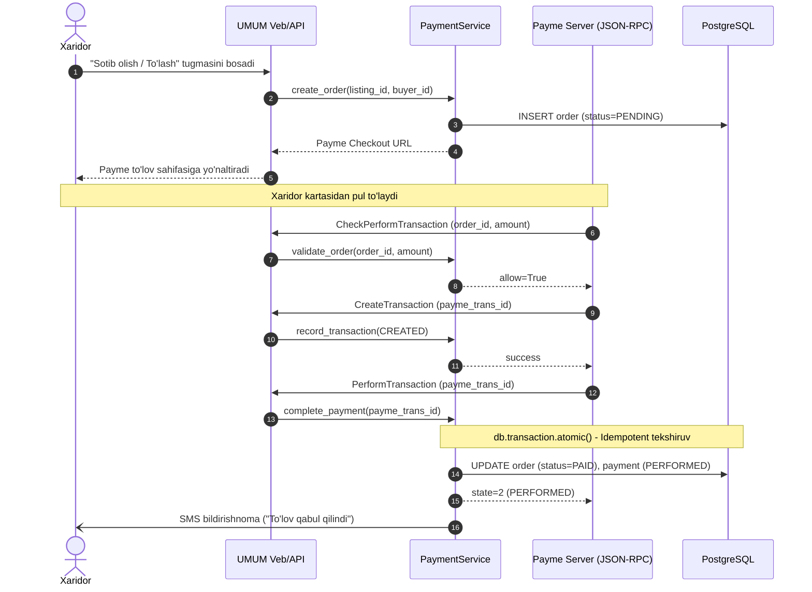
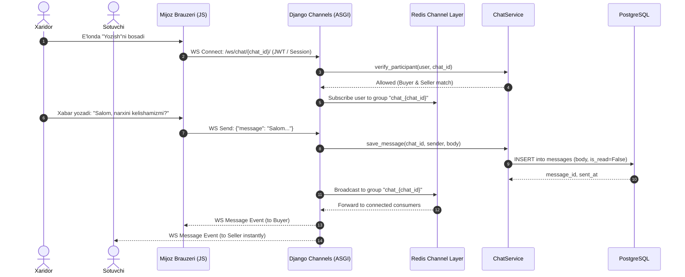
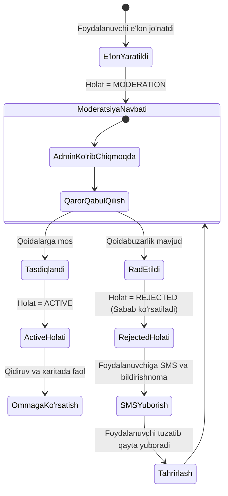

# UMUM — Full-Stack Marketplace Platform
## Tizim Talablari Tahlili (Phase 1) va Tizim Arxitekturasi (Phase 2)
**Hujjat turi:** Dasturiy ta'minot arxitekturasi va spetsifikatsiyasi  
**Texnologik stek:** Python 3.12 | Django 5.2 LTS | Django REST Framework | Django Templates | Jazzmin 3.0.5 | PostgreSQL 16 | Redis | Channels | Leaflet.js | Payme JSON-RPC

---

# 1. KIRISH VA TEXNOLOGIK TRANFORMATSIYA

`UMUM_platfo'rmasi.dotx` hujjati tahlil qilindi. Dastlabki hujjatda backend **Java Spring Boot**, veb-frontend esa **React/Next.js** sifatida loyihalashtirilgan. 

Ushbu loyihani senior muhandislik darajasida ishlab chiqish uchun quyidagi me'moriy qarorlar qabul qilindi:
1. **Backend & Veb Frontend birlashtirildi:** Java Spring Boot va React o'rniga zamonaviy **Python 3.12 + Django 5.2 LTS** qabul qilindi.
2. **Dual-Frontend arxitekturasi:**
   - **Veb qismi:** Server-rendered **Django Templates + Bootstrap 5 + Leaflet.js + Vanilla JS**.
   - **API qismi:** Kelajakdagi mobil ilovalar (Android / iOS) va tashqi integratsiyalar uchun to'liq **Django REST Framework (DRF)** REST API (`/api/v1/`).
3. **Yagona biznes mantiq (Shared Business Logic):** Veb-kontrollerlar ham, API-kontrollerlar ham ayni bir xil **Services** va **Repositories** qatlamidan foydalanadi. Biznes qoidalar (e'lon yaratish, to'lov, xarid, tekshirish) hech qachon takrorlanmaydi (DRY prinsipi).
4. **Admin boshqaruvi:** `django-jazzmin==3.0.5` asosida professional boshqaruv paneli.

---

# PHASE 1 — TALABLAR TAHLILI (REQUIREMENTS ANALYSIS)

## 1. Funksional Talablar (FR-01 — FR-22) va MoSCoW Tahlili

| ID | Modul | Talab tavsifi | MoSCoW | Yangi arxitekturadagi o'rni |
|---|---|---|---|---|
| **FR-01** | Ro'yxatdan o'tish & Auth | Telefon raqami va SMS-kod orqali OTP autentifikatsiya. Sessiya (web) va JWT (API). | **Must** | `apps.accounts` (AuthService, SMSService) |
| **FR-02** | Foydalanuvchi profili | Ism, profil rasmi, shahar va aloqa ma'lumotlarini tahrirlash. | **Must** | `apps.accounts` (UserProfileService) |
| **FR-03** | E'lon qo'shish | Sarlavha, tavsif, narx, kategoriya, rasmlar, geolokatsiya (lat/lng) bilan yaratish. | **Must** | `apps.listings` (ListingService) |
| **FR-04** | E'lon boshqaruvi | O'z e'lonlarini tahrirlash, arxivlash, faollashtirish va o'chirish. | **Must** | `apps.listings` (ListingService) |
| **FR-05** | Kategoriyalar | Daraxtsimon (ierarxik: ota-bola) kategoriyalar tuzilmasi. | **Must** | `apps.categories` (CategoryService) |
| **FR-06** | Qidiruv va filtr | Kalit so'z, kategoriya, narx diapazoni, shahar va sanalar bo'yicha qidiruv. | **Must** | `apps.search` (SearchService) |
| **FR-07** | E'lon tafsilotlari | E'lon sahifasida rasmlar galereyasi, tavsif, narx, sotuvchi info, interaktiv xarita. | **Must** | `apps.listings` (ListingDetailView / API) |
| **FR-08** | Interaktiv xarita | OpenStreetMap + Leaflet.js orqali e'lonlarni xaritada ko'rish va hudud bo'yicha izlash. | **Must** | `apps.listings`, `integrations.maps` |
| **FR-09** | Sevimlilar (Favorites) | E'lonlarni sevimlilarga qo'shish va olib tashlash. | **Should** | `apps.favorites` (FavoriteService) |
| **FR-10** | Real-vaqt chat | Xaridor va sotuvchi o'rtasida e'lon kontekstida real-vaqtda xabarlashuv (WebSocket). | **Must** | `apps.chats` (Channels, Redis) |
| **FR-11** | To'lov (Payme) | Payme Merchant API (JSON-RPC) orqali to'lov yaratish, tekshirish va tasdiqlash. | **Must** | `apps.payments`, `integrations.payme` |
| **FR-12** | To'lov idempotentligi | Takroriy so'rovlar (webhook) xavfsiz va dublikatsiz tranzaksiyada ishlanishi kerak. | **Must** | `apps.payments` (PaymentService) |
| **FR-13** | SMS bildirishnomalar | OTP kodlar, to'lov holati va moderatsiya natijalari bo'yicha SMS jo'natish. | **Must** | `apps.notifications`, `integrations.sms` |
| **FR-14** | AI Yordamchi | Tavsifni boyitish, narx tavsiya etish va semantik qidiruvda ko'maklashish. | **Should** | `apps.ai_assistant`, `integrations.ai` |
| **FR-15** | E'lon moderatsiyasi | Yangi/tahrirlangan e'lonlar admin tasdiqlagachgina ommaga chiqadi. | **Must** | `apps.moderation` (ModerationService) |
| **FR-16** | Shikoyatlar (Reports) | E'lon yoki qoidabuzar foydalanuvchi ustidan sabab ko'rsatib shikoyat berish. | **Should** | `apps.reports` (ReportService) |
| **FR-17** | Admin panel | Foydalanuvchilar, kategoriyalar, e'lonlar, tizim sozlamalarini boshqarish. | **Must** | `django-jazzmin` boshqaruvi |
| **FR-18** | Statistika va hisobotlar | Admin uchun platforma ko'rsatkichlari, tushumlar, faollik hisobotlari. | **Should** | `apps.analytics` (AnalyticsService) |
| **FR-19** | Ko'p tillilik (i18n) | O'zbek, Rus va Ingliz tillariga mos arxitektura tayyorligi. | **Could** | `django.utils.translation` |
| **FR-20** | Audit jurnali | To'lov, moderatsiya, rol o'zgarishi va xavfsizlik amallarini loglash. | **Should** | `apps.audit` (AuditService) |
| **FR-21** | Mehmon rejimi | Akkauntsiz ko'rish/qidirish; himoyalangan amal tanlanganda avtomatik login va qaytish. | **Must** | `apps.common` (NextURL middleware/helper) |
| **FR-22** | Sotuvchi profili | Ilk e'londan avval Ism, Shahar va Aloqa ma'lumotlarini majburiy to'ldirish. | **Must** | `apps.accounts` (SellerProfileService) |

---

## 2. Nofunksional Talablar (NFR-01 — NFR-10) va Verifikatsiya

1. **NFR-01 (Unumdorlik - Performance):** Qidiruv so'rovlarining 95% 2 soniya ichida qaytishi kerak.
   - *Amalga oshirish:* PostgreSQL B-Tree indekslari (`category_id`, `status`, `city`), trigram/full-text indekslar (`title`, `description`), N+1 so'rovlarni `select_related`/`prefetch_related` orqali yo'qotish.
2. **NFR-02 (Mavjudlik - Availability):** Oylik 99% xizmat ko'rsatish darajasi (SLA).
   - *Amalga oshirish:* Docker Compose konteynerizatsiyasi, `gunicorn` / `daphne` workerlari, `healthcheck` endpointlari.
3. **NFR-03 (Xavfsizlik - Security):** BCrypt/PBKDF2 parollar xeshlash, JWT tokenlar, HTTPS/TLS, CORS/CSRF himoyasi, SQL Injection va XSS dan to'liq himoya.
4. **NFR-04 (Maxfiylik - Privacy):** Foydalanuvchilarning shaxsiy ma'lumotlari (SMS kod, parol xeshi, boshqa shaxslar yozishmalari) tashqi dunyoga yoki ruxsat etilmagan foydalanuvchiga hech qachon chiqmaydi.
5. **NFR-05 (Ishonchlilik - Reliability):** Buyurtma va to'lov jarayonlari `django.db.transaction.atomic()` ichida bajariladi. Payme JSON-RPC idempotentligi to'liq ta'minlanadi.
6. **NFR-06 (Kengayuvchanlik - Scalability):** Qatlamli arxitektura (Layers). Yangi to'lov provayderi (masalan, Click) yoki yangi AI modeli qo'shilganda asosiy kod o'zgarmaydi.
7. **NFR-07 (Qulaylik - Usability):** E'lon berish 3 qadamda amalga oshiriladi (Kategoriya -> Ma'lumotlar -> Joylashuv/Rasmlar). Mobil qurilmalarga to'liq adaptiv (Bootstrap 5).
8. **NFR-08 (Audit):** Barcha kritik amallar `AuditLog` jadvaliga kim, qachon, qaysi obyekt ustida qanday amal bajarganini qayd etadi.
9. **NFR-09 (Moslashuvchanlik - Compatibility):** Veb brauzerlar (Chrome, Firefox, Safari, Edge) va kelajakdagi mobil ilovalar uchun yagona REST API standarti.
10. **NFR-10 (Xizmat ko'rsatish - Maintainability):** Modulli tuzilma, PEP-8 standartlari, avtomatlashtirilgan unit/integratsion testlar, OpenAPI/Swagger avtomatik hujjatlashtirish.

---

## 3. Asosiy Use Caselar (UC-01 — UC-08) Spetsifikatsiyasi

### UC-01. Ro'yxatdan o'tish / Tizimga kirish (OTP Flow)
- **Aktor:** Mehmon, SMS provayder.
- **Old shart:** Foydalanuvchi tizimda ro'yxatdan o'tmagan yoki sessiyasi tugagan.
- **Asosiy oqim:**
  1. Mehmon telefon raqamini kiritadi (`+998901234567`).
  2. Tizim SMS orqali 6 xonali OTP kod yuboradi va uni muddati (masalan, 2 daqiqa) bilan keshga/bazaga saqlaydi.
  3. Foydalanuvchi kodni kiritadi.
  4. Tizim tekshiradi: agar yangi raqam bo'lsa, `User` yaratiladi; mavjud bo'lsa, tizimga kiriladi.
  5. Veb uchun sessiya ochiladi, API uchun esa Access va Refresh JWT tokenlar qaytariladi.
- **Muqobil oqim:** Kod noto'g'ri yoki eskirgan bo'lsa, xato xabari ko'rsatiladi va urinishlar soni kamaytiriladi (maksimal 3 urinish).

### UC-02. E'lon qo'shish
- **Aktor:** Ro'yxatdan o'tgan foydalanuvchi.
- **Old shart:** Tizimga kirgan. Birinchi marta bo'lsa, `seller_profile_completed == True` bo'lishi shart (FR-22).
- **Asosiy oqim:**
  1. Foydalanuvchi kategoriya tanlaydi.
  2. Sarlavha, tavsif, narx, geomanzil (xaritada tanlanadi) va rasmlarni kiritadi.
  3. (Ixtiyoriy) "AI orqali boyitish" tugmasini bosib, tavsif va narx tavsiyasini oladi.
  4. "E'lonni yuborish" tugmasi bosiladi.
  5. E'lon `MODERATION` holatida saqlanadi va admin navbatiga tushadi.

### UC-03. Qidiruv va Filtrlash
- **Aktor:** Mehmon yoki Ro'yxatdan o'tgan foydalanuvchi.
- **Asosiy oqim:** Kalit so'z, kategoriya, minimal/maksimal narx, shahar tanlanadi. Xarita yoki ro'yxat ko'rinishida `ACTIVE` holatidagi e'lonlar saralanib chiqariladi.

### UC-04. Real-vaqt Chat
- **Aktor:** Xaridor, Sotuvchi.
- **Old shart:** Ikkala tomon tizimga kirgan; e'lon mavjud.
- **Asosiy oqim:**
  1. Xaridor e'londa "Sotuvchiga yozish" tugmasini bosadi.
  2. Tizim ushbu e'lon bo'yicha ikkala foydalanuvchi o'rtasidagi chat xonasini ochadi (yoki yangi yaratadi).
  3. WebSocket (`/ws/chat/{chat_id}/`) ulanishi o'rnatiladi.
  4. Xabarlar darhol yetkaziladi va `Message` jadvaliga saqlanadi.

### UC-05. Payme orqali to'lov
- **Aktor:** Xaridor, Payme tizimi.
- **Asosiy oqim:**
  1. Xaridor "Sotib olish / To'lash" tugmasini bosadi.
  2. Tizim `Order` ni `PENDING` holatida yaratadi.
  3. Payme checkout havolasi ochiladi.
  4. Xaridor to'lovni amalga oshirgach, Payme serveri bizning `/api/v1/payments/payme/` endpointimizga `CheckPerformTransaction` va `PerformTransaction` so'rovlarini yuboradi.
  5. Tizim tranzaksiyani tekshirib, `Payment` ni `PERFORMED`, `Order` ni `PAID` holatiga o'tkazadi va SMS bildirishnoma yuboradi.

### UC-06. E'lon moderatsiyasi
- **Aktor:** Administrator.
- **Asosiy oqim:** Admin navbatdagi `MODERATION` e'lonlarni ko'radi, ularni `ACTIVE` qiladi yoki sabab ko'rsatib `REJECTED` holatiga o'tkazadi. Foydalanuvchiga SMS/tizim xabarnomasi boradi.

### UC-07. AI Yordamchi
- **Aktor:** Foydalanuvchi.
- **Asosiy oqim:** Foydalanuvchi xomaki matn kiritadi; backend LLM integratsiyasi orqali jozibali tavsif va bozor narxiga oid tahlilni qaytaradi. Foydalanuvchi taklifni qabul qilsa, forma maydonlari yangilanadi.

### UC-08. Shikoyat yuborish (Reports)
- **Aktor:** Foydalanuvchi.
- **Asosiy oqim:** Foydalanuvchi nojo'ya e'lon yoki firibgar sotuvchi ustidan shikoyat sababi va izohini yuboradi. Admin ushbu arizani ko'rib chiqib chora ko'radi.

---

## 4. Dastlabki SRS va Django Arxitekturasi o'rtasidagi Nomuvofiqliklar Tahlili

Hujjat tahlili davomida quyidagi nomuvofiqliklar va ularning professional yechimlari belgilandi:

| № | Dastlabki SRS hujjati | Aniqlangan muammo | Arxitekturaviy Senior Yechim |
|---|---|---|---|
| **1** | **FR-16** shikoyat e'lon yoki **foydalanuvchi** ustidan berilishi mumkin deydi. Ammo 11-bo'limdagi `Report` modelida faqat `listing_id` ko'rsatilgan. | Foydalanuvchi (profil/sotuvchi) ustidan to'g'ridan-to'g'ri shikoyat yuborish imkoni yo'qoladi. | `Report` modeliga `reported_user_id = ForeignKey(User, null=True, blank=True)` qo'shildi. Endi tizim e'longa ham, foydalanuvchiga ham shikoyat qabul qila oladi. |
| **2** | Dastlabki hujjatda veb-frontend Next.js (SPA) va API yagona backend deb qaralgan. | Django Templates server-rendered bo'lib, CSRF va Sessiya asosida ishlaydi, mobil ilova esa JWT talab qiladi. | **Gibrid Autentifikatsiya:** Veb uchun Django Session + CSRF, mobil ilovalar va tashqi API uchun JWT (`rest_framework_simplejwt`). Ikkala qatlam ham bir xil `AuthService` dan foydalanadi. |
| **3** | Java Spring Boot arxitekturasida Controller -> Service -> Repository qatlamlari klassik tarzda alohida classlar bo'ladi. | Django odatda "Fat Models" yoki "Fat Views" uslubida yoziladi, bu esa kodning chigallashishiga olib keladi. | Djangoda **Clean Layered Architecture** joriy etildi: `apps.<app>.controllers` (Web va API), `apps.<app>.services` (Sof biznes mantiq), `apps.<app>.repositories` (Query va ORM izolyatsiyasi). |
| **4** | Real-vaqt chat dastlabki arxitekturada alohida servis deb ko'rsatilgan. | Djangoning standart WSGI serveri WebSockets ni qo'llab-quvvatlamaydi. | **Django Channels + ASGI + Redis Channel Layer** joriy etildi. HTTP so'rovlar WSGI/ASGI orqali, chat esa WebSockets orqali yagona portda boshqariladi. |

---

## 5. Talablar Izlanuvchanlik Matritsasi (Traceability Matrix)

| Req ID | Nomi | Django App | Controller | Service | Repository | Model | API Endpoint | Web Page | Test Case |
|---|---|---|---|---|---|---|---|---|---|
| **FR-01** | Auth / OTP | `accounts` | `WebAuthController` / `ApiAuthController` | `AuthService` | `UserRepository` | `User` | `/api/v1/auth/*` | `/auth/login/` | TC-01, TC-02 |
| **FR-02** | User Profile | `accounts` | `WebProfileController` / `ApiUserController` | `UserProfileService` | `UserRepository` | `User` | `/api/v1/users/me` | `/profile/` | TC-01 |
| **FR-03** | Create Listing | `listings` | `WebListingController` / `ApiListingController` | `ListingService` | `ListingRepository` | `Listing`, `ListingImage` | `POST /api/v1/listings` | `/listings/create/` | TC-03, TC-04 |
| **FR-04** | Manage Listing | `listings` | `WebListingController` / `ApiListingController` | `ListingService` | `ListingRepository` | `Listing` | `PUT/DELETE /api/v1/listings/{id}` | `/listings/my/` | TC-10 |
| **FR-05** | Categories | `categories` | `WebCategoryController` / `ApiCategoryController`| `CategoryService` | `CategoryRepository`| `Category` | `/api/v1/categories` | Bosh sahifa, Menyu | TC-03 |
| **FR-06** | Search | `search` | `WebSearchController` / `ApiListingController` | `SearchService` | `ListingRepository` | `Listing` | `GET /api/v1/listings?search=`| `/search/` | TC-05 |
| **FR-07** | Listing Details| `listings` | `WebListingController` / `ApiListingController` | `ListingService` | `ListingRepository` | `Listing` | `GET /api/v1/listings/{id}` | `/listings/{id}/` | TC-07 |
| **FR-08** | Map | `listings` | `WebMapController` / `ApiMapController` | `MapService` | `ListingRepository` | `Listing` | `GET /api/v1/listings/map` | `/map/` | US-03 |
| **FR-09** | Favorites | `favorites`| `WebFavoriteController`/ `ApiFavoriteController`| `FavoriteService` | `FavoriteRepository`| `Favorite` | `/api/v1/favorites/{id}` | `/favorites/` | US-09 |
| **FR-10** | Chat | `chats` | `WebChatController` / `ApiChatController` | `ChatService` | `ChatRepository` | `Chat`, `Message` | `/api/v1/chats`, `/ws/chat`| `/chats/` | TC-06 |
| **FR-11** | Payme Payment | `payments` | `PaymeWebhookController` / `WebPaymentController`| `PaymentService` | `PaymentRepository` | `Payment`, `Order` | `POST /api/v1/payments/payme` | `/payments/{id}/` | TC-07, TC-08 |
| **FR-12** | Idempotency | `payments` | `PaymeWebhookController` | `PaymentService` | `PaymentRepository` | `Payment` | `POST /api/v1/payments/payme` | N/A (Backend) | TC-09 |
| **FR-13** | SMS Notify | `notifications`| N/A (Internal & Events) | `NotificationService`| `NotificationRepository`| `Notification`| N/A | N/A | US-08 |
| **FR-14** | AI Assistant | `ai_assistant`| `WebApiAssistantController` / `ApiAiController` | `AIService` | N/A | N/A | `/api/v1/ai/*` | `/ai-assistant/` | TC-12 |
| **FR-15** | Moderation | `moderation`| `AdminModerationController` | `ModerationService` | `ListingRepository` | `Listing` | `/api/v1/moderation/*` | Jazzmin Admin | US-10 |
| **FR-16** | Reports | `reports` | `WebReportController` / `ApiReportController` | `ReportService` | `ReportRepository` | `Report` | `/api/v1/reports` | Modal forma | US-11 |
| **FR-17** | Admin Panel | `admin` | Django Admin Site (Jazzmin) | Admin Services | ORM Managers | All Models | Django Admin URL | `/admin/` | TC-11 |
| **FR-18** | Analytics | `analytics` | `AdminAnalyticsController` | `AnalyticsService` | Analytics Queries | All Models | `/api/v1/admin/stats` | `/admin/` | US-12 |
| **FR-19** | Multilingual | `common` | Middleware & Context Processors | Translation API | N/A | N/A | Accept-Language | Til almashtirgich | NFR-09 |
| **FR-20** | Audit Logs | `audit` | Audit Middleware / Event Signals | `AuditService` | `AuditRepository` | `AuditLog` | `/admin/audit/` | Jazzmin Admin | NFR-08 |
| **FR-21** | Guest Mode | `common` | `GuestRedirectMiddleware` | Session Store | N/A | N/A | Query `?next=` | Barcha sahifalar | UC-01 |
| **FR-22** | Seller Profile | `accounts` | `WebSellerController` / `ApiUserController` | `SellerProfileService`| `UserRepository` | `User` | `/api/v1/users/me` | `/profile/seller/`| UC-02 |

---

# PHASE 2 — TIZIM ARXITEKTURASI (SYSTEM ARCHITECTURE)

## 1. Dual-Frontend Arxitekturasi Tamoyili

UMUM platformasining asosi — **Taqdimot qatlami (Presentation Layer) mustaqilligi**. 
Veb foydalanuvchisi brauzer orqali forma to'ldiradimi yoki kelajakdagi Flutter/React Native mobil ilovasi JSON yuboradimi — tizimning **barcha biznes qoidalari faqat bir joyda (Services)** bajariladi.

```text
                            +-----------------------------------------+
                            |            MIJOZLAR (CLIENTS)           |
                            +--------------------+--------------------+
                                                 |
                       +-------------------------+-------------------------+
                       |                                                   |
                       v                                                   v
           +-----------------------+                           +-----------------------+
           |     DESKTOP/MOBIL     |                           |    MOBIL ILOVALAR     |
           |     VEB BRAUZER       |                           |    (Android / iOS)    |
           +-----------+-----------+                           +-----------+-----------+
                       | HTML / Form / Cookie                              | JSON / Bearer Token
                       v                                                   v
+---------------------------------------------------------------------------------------------------+
| TAQDIMOT QATLAMI (PRESENTATION LAYER)                                                             |
|                                                                                                   |
|  [DJANGO TEMPLATES APP]                                           [DJANGO REST FRAMEWORK APP]     |
|  - Web Controllers (Class/Func Views)                             - API Controllers (APIViews)    |
|  - Django Forms & Formsets                                        - DRF Serializers               |
|  - Session & CSRF Auth                                            - JWT (SimpleJWT) Auth          |
|  - HTML5, Bootstrap 5, Leaflet.js                                 - OpenAPI / Swagger Docs        |
+------------------------------------+-----------------------------+--------------------------------+
                                     |                             |
                                     +--------------+--------------+
                                                    |
                                                    v
+---------------------------------------------------------------------------------------------------+
| BIZNES MANTIQ QATLAMI (APPLICATION & SERVICES LAYER)                                              |
|                                                                                                   |
|   - AuthService (OTP generation, verification, user activation)                                   |
|   - ListingService (Creation, moderation submission, archiving, validation)                       |
|   - CategoryService (Tree structure, cached navigation)                                           |
|   - PaymentService (Payme JSON-RPC, idempotency, order transitions)                               |
|   - ChatService (Message persistence, unread tracking, room validation)                           |
|   - AIService (Prompt engineering, description refinement, price suggestions)                     |
|   - NotificationService (SMS dispatch, in-app notification routing)                               |
|   - ModerationService (Admin queue, status transition enforcement)                                |
+---------------------------------------------------+-----------------------------------------------+
                                                    |
                                                    v
+---------------------------------------------------------------------------------------------------+
| MA'LUMOTLAR BILAN ISHLASH QATLAMI (DATA ACCESS / REPOSITORY LAYER)                                |
|                                                                                                   |
|   - UserRepository, ListingRepository, CategoryRepository, ChatRepository, PaymentRepository     |
|   - Murakkab SQL / ORM so'rovlari, filterlash, tranzaksiya izolyatsiyasi                         |
+---------------------------------------------------+-----------------------------------------------+
                                                    |
                                                    v
+---------------------------------------------------------------------------------------------------+
| MA'LUMOTLAR MODELI VA SAQLASH (PERSISTENCE LAYER)                                                 |
|                                                                                                   |
|   - Django ORM Models (User, Category, Listing, Order, Payment, Chat, Message, AuditLog, etc.)   |
|   - PostgreSQL 16 (Relational DB, Foreign Keys, B-Tree & Trigram Indexes, Constraints)            |
|   - Redis 7 (Channels Channel Layer, Session Caching, OTP Temporary Cache)                       |
+---------------------------------------------------------------------------------------------------+
```

---

## 2. Loyiha Qatlamlari va Ularning Vazifalari

1. **Controllers (Nazoratchilar):**
   - *Web Controllers:* HTTP so'rovlarini qabul qiladi, `forms.py` orqali validatsiya qiladi, tegishli `Service`ni chaqiradi va `render(request, 'template.html', context)` orqali HTML qaytaradi.
   - *API Controllers:* JSON so'rovlarini qabul qiladi, `serializers.py` orqali validatsiya qiladi, ayni o'sha `Service`ni chaqiradi va `Response(data, status=...)` qaytaradi.
   - *Muhim qoida:* Kontrollerlar ichida hech qachon murakkab biznes qoidalar (masalan, "agar narx 0 bo'lsa yoki balans yetmasa...") yozilmaydi.
2. **Services (Xizmatlar):**
   - Platformaning asosiy "miyasi". Biznes qoidalarni tekshiradi, hisob-kitoblarni amalga oshiradi, bir nechta modellar bilan ishlaganda `transaction.atomic()` orqali ma'lumotlar yaxlitligini kafolatlaydi.
   - Kontrollerlardan HTTP request yoki Response obyektlarini qabul qilmaydi va qaytarmaydi (sof Python ma'lumotlari: dict, DTO yoki model obyektlari bilan ishlaydi).
3. **Repositories (Repozitoriylar):**
   - Ma'lumotlar bazasiga kirish nuqtasi. Murakkab querylarni, aggregatsiyalarni, `select_related`/`prefetch_related` optimallashtirishlarini o'zida saqlaydi. Servis qatlami bazaning qanday so'rov orqali olinganini bilishi shart emas.
4. **Models (Modellar):**
   - PostgreSQL jadvallarini ifodalovchi Django ORM modellari. Barcha mantiqiy cheklovlar (`CheckConstraint`, `UniqueConstraint`), indekslar (`db_index=True`, `Index`) shu yerda joylashadi.
5. **Integrations (Tashqi xizmatlar adapterlari):**
   - Payme, SMS (Eskiz), AI (Gemini/OpenAI), OpenStreetMap kabi tashqi xizmatlar bilan aloqani ta'minlovchi alohida klasslar. Ular mock (sandbox) rejimida ham, haqiqiy API rejimida ham bir xil interfeys orqali ishlaydi.
6. **Config (Konfiguratsiya):**
   - Sozlamalar modulli tuzilmada: `config/settings/base.py`, `development.py`, `production.py`.

---

## 3. Holatlar Boshqaruvi (State Transitions)

Tizimdagi barcha muhim obyektlar aniq `TextChoices` holatlariga ega va ruxsatsiz holat o'zgartirish qat'iyan taqiqlanadi:

```text
[Listing Holatlari]:
  (Yaratish) -> DRAFT -> MODERATION -> ACTIVE -> SOLD / ARCHIVED
                               |
                               +-----> REJECTED -> (Tahrirlash) -> MODERATION

[Order Holatlari]:
  (Xarid) -> PENDING -> PAID (Payme tasdiqlagach)
                |
                +-----> FAILED / CANCELLED

[Payment Holatlari]:
  (Initsializatsiya) -> CREATED -> PERFORMED -> CANCELLED / FAILED

[User Holatlari]:
  ACTIVE <---------> BLOCKED (Admin tomonidan)

[Report Holatlari]:
  OPEN -> REVIEWED -> CLOSED
```

---

## 4. Tizim Arxitekturasi va Ketma-ketlik Diagrammalari (Mermaid)

### 4.1. Umumiy Tizim Arxitekturasi (System Architecture)


### 4.2. Qatlamlar o'rtasidagi aloqa (Layer Communication)


### 4.3. Ma'lumotlar Bazasi ER Diagrammasi (Database ER Diagram)


### 4.4. Use Case Diagrammasi (Use Case Diagram)


### 4.5. E'lon Yaratish Ketma-ketlik Diagrammasi (Listing Creation Sequence Diagram)


### 4.6. Payme To'lov Ketma-ketlik Diagrammasi (Payme Payment Sequence Diagram)


### 4.7. Real-Vaqt Chat Ketma-ketlik Diagrammasi (WebSocket & Channels)


### 4.8. E'lonlarni Moderatsiya Qilish Faoliyat Diagrammasi (Activity Diagram)


---

## 5. Loyihaning To'liq Katalog va Fayllar Tuzilmasi

Loyiha quyidagi standart arxitektura bo'yicha tuziladi:

```text
UMUM/
├── manage.py
├── requirements.txt
├── .env
├── .env.example
├── .gitignore
├── Dockerfile
├── docker-compose.yml
├── README.md
│
├── config/
│   ├── __init__.py
│   ├── urls.py
│   ├── asgi.py
│   ├── wsgi.py
│   └── settings/
│       ├── __init__.py
│       ├── base.py
│       ├── development.py
│       └── production.py
│
├── apps/
│   ├── common/              # Umumiy base modellar, xatolar, utilitalar
│   │   ├── models/
│   │   ├── services/
│   │   ├── permissions/
│   │   ├── exceptions/
│   │   └── utilities/
│   │
│   ├── accounts/            # FR-01, FR-02, FR-22: Foydalanuvchi, Auth, OTP, Sotuvchi profili
│   │   ├── models/
│   │   ├── controllers/
│   │   │   ├── web/
│   │   │   └── api/
│   │   ├── services/
│   │   ├── repositories/
│   │   ├── serializers/
│   │   ├── forms/
│   │   ├── urls/
│   │   └── admin.py
│   │
│   ├── categories/          # FR-05: Ierarxik kategoriyalar
│   ├── listings/            # FR-03, FR-04, FR-07, FR-08: E'lonlar, Rasmlar, Xarita
│   ├── favorites/           # FR-09: Sevimlilar
│   ├── search/              # FR-06: Qidiruv va filtrlar
│   ├── chats/               # FR-10: Real-vaqt chat, Channels, WebSockets
│   ├── orders/              # FR-11: Buyurtmalar
│   ├── payments/            # FR-11, FR-12: Payme JSON-RPC integratsiyasi
│   ├── notifications/       # FR-13: SMS va tizim xabarlari
│   ├── ai_assistant/        # FR-14: Tavsif boyitish, narx tavsiyasi
│   ├── moderation/          # FR-15: Moderatsiya navbati va nazorat
│   ├── reports/             # FR-16: Shikoyatlar
│   ├── analytics/           # FR-18: Admin statistikasi
│   └── audit/               # FR-20: Muhim amallar logi
│
├── integrations/            # Tashqi API mijozlari (Payme, Eskiz SMS, AI, Maps)
│   ├── payme/
│   ├── sms/
│   ├── ai/
│   └── maps/
│
├── templates/               # Django Templates (13 ta to'liq ekran)
│   ├── base.html
│   ├── components/          # Header, footer, navbar, pagination, listing_card
│   ├── home/                # Bosh sahifa
│   ├── listings/            # E'lonlar ro'yxati, batafsil, yaratish
│   ├── accounts/            # Login, OTP tasdiqlash, profil, sotuvchi formasi
│   ├── chats/               # Chat oynasi (WebSocket JS bilan)
│   ├── payments/            # To'lov va buyurtma natijasi
│   ├── map/                 # To'liq ekranli Leaflet.js xaritasi
│   ├── ai_assistant/        # AI yordamchi sahifasi
│   └── errors/              # 400, 403, 404, 500
│
├── static/
│   ├── css/                 # Custom CSS + Bootstrap 5
│   ├── js/                  # Leaflet xarita skriptlari, WebSocket chat client
│   └── images/
│
├── media/                   # Foydalanuvchilar yuklagan e'lon rasmlari
└── tests/                   # TC-01 dan TC-12 gacha unit va integratsiya testlari
```

---

# XULOSA VA KEYINGI BOSQICHLAR (NEXT PHASES)

Ushbu arxitektura va talablar tahlili loyihaning barcha 22 ta funksional, 10 ta nofunksional, 8 ta Use Case va 12 ta User Story talablarini to'liq qamrab oladi.

Navbatdagi amalga oshirish bosqichlari:
- **Phase 3:** Loyiha poydevori (Django sozlamalari, Jazzmin 3.0.5, PostgreSQL/Redis ulanishi, Docker, requirements.txt).
- **Phase 4:** Baza modellari va migratsiyalar (Custom User, Category, Listing, Order, Payment, Chat, Message, Report, AuditLog).
- **Phase 5:** Repozitoriylar va Services (Biznes mantiq).
- **Phase 6:** Django REST Framework API (Serializers, ViewSets, Swagger).
- **Phase 7:** Django Templates Veb interfeysi (13 ta sahifa, Bootstrap 5, Leaflet.js xarita, real-vaqt chat).
- **Phase 8:** Tashqi integratsiyalar (Payme JSON-RPC, Eskiz SMS, AI).
- **Phase 9:** Jazzmin admin paneli sozlamalari.
- **Phase 10:** Sinov (TC-01..TC-12) va yakuniy tekshiruv.
